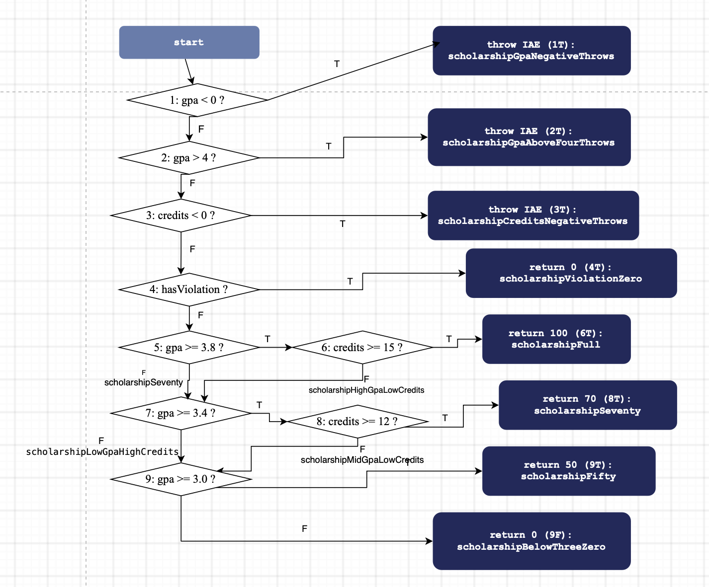

# Лаб 09 — Код хамралт (JaCoCo)

**F.CSA313 — Программ хангамжийн чанарын баталгаа ба тест (2026)**

- **Оюутны нэр:** Ч.Оюумаа
- **Оюутны код:** B232270133

## Орчин

```
$ java -version
openjdk version "27" 2026-09-15
OpenJDK Runtime Environment Homebrew (build 27)
OpenJDK 64-Bit Server VM Homebrew (build 27, mixed mode, sharing)

$ mvn -version
Apache Maven 3.9.16 (2bdd9fddda4b155ebf8000e807eb73fd829a51d5)
Maven home: /opt/homebrew/Cellar/maven/3.9.16/libexec
Java version: 27, vendor: Homebrew, runtime: /opt/homebrew/Cellar/openjdk/27/libexec/openjdk.jdk/Contents/Home
Default locale: en_MN, platform encoding: UTF-8
OS name: "mac os x", version: "26.1", arch: "aarch64", family: "mac"
```

JUnit 5 ба JaCoCo 0.8.12 (Maven plugin) ашигласан.

## Репозиторийн бүтэц

| Файл | Зориулалт |
|---|---|
| `pom.xml` | JUnit 5 + JaCoCo тохиргоо (багшийн өгсөн) |
| `src/main/java/mn/edu/must/sqat/ScholarshipCalculator.java` | Тестлэгдэх класс (багшийн өгсөн, Хэсэг D-д нэг мөр засав) |
| `src/test/java/mn/edu/must/sqat/ScholarshipCalculatorTest.java` | Миний бичсэн тестүүд — нийт **31 тест** |
| `cfg.png` | `scholarship()` функцийн гараар зурсан CFG |
| `results/mvn-verify-A.txt`, `results/jacoco-A.csv` | Хэсэг A: happy-path тестийн гаралт ба хамралт |
| `results/mvn-verify-B.txt`, `results/jacoco-B.csv` | Хэсэг B: 100% хамралтын гаралт ба хамралт |
| `results/mvn-test-D-fail.txt` | Хэсэг D: зааг утгын тест унасан гаралт |
| `results/mvn-verify-final.txt`, `results/jacoco-final.csv` | Алдаа засагдсаны дараах эцсийн гаралт ба хамралт |

---

## Хэсэг A — Happy path тестүүд ба эхний хэмжилт

5 happy-path тест бичиж (`letterGradeA`, `gpaTwoScores`, `scholarshipFull`, `scholarshipSeventy`, `scholarshipFifty`) хамралтыг хэмжсэн.

| Хэмжүүр | Covered / Нийт | Хувь | Эх сурвалж |
|---|---|---|---|
| Branch | 22 / 41 | **53.7%** | `results/jacoco-A.csv`: BRANCH_COVERED 22, BRANCH_MISSED 19 |
| Line | 16 / 25 | **64.0%** | `results/jacoco-A.csv`: LINE_COVERED 16, LINE_MISSED 9 |

`results/mvn-verify-A.txt`: `Tests run: 5, Failures: 0`.

**Ажиглалт:** Улаан мөрүүд нь голдуу алдааны замууд (`IllegalArgumentException` шидэх мөрүүд) болон happy-path тестэд ороогүй дүнгүүд (`letterGrade`-ийн C, D, F, `gpa`-ийн `switch`-ийн C, D, default салаа, `scholarship`-ийн сахилгын зөрчил ба `return 0` замууд) байсан. Шар ромботой мөрүүд нь `||` болон `&&` нөхцөлтэй `if`-үүд бөгөөд нөхцөл тус бүрийн зөвхөн нэг утга (үнэн эсвэл худал) шалгагдсан тул салаа хагас дутуу хамрагдсан.

---

## Хэсэг B — CFG зурж branch 100% хүрэх



`scholarship()` функцийн CFG-г draw.io дээр гараар зурсан. Нөхцөл бүр (`gpa < 0`, `gpa > 4`, `credits < 0`, `hasViolation`, `gpa >= 3.8`, `credits >= 15`, `gpa >= 3.4`, `credits >= 12`, `gpa >= 3.0`) тусдаа зангилаа, учир нь JaCoCo `||` ба `&&`-ийн нөхцөл бүрийг тусдаа салаа гэж тоолдог. Ирмэг бүр дээр түүнийг дайрах тестийн нэрийг бичсэн (нэрс нь тестийн файлын метод нэртэй яг таарна).

Тест нэмж 100%-д хүргэсэн:

| Хэмжүүр | Үр дүн | Эх сурвалж |
|---|---|---|
| Нийт тест | **22** | `results/mvn-verify-B.txt`: `Tests run: 22, Failures: 0` |
| Branch | 41 / 41 | `results/jacoco-B.csv`: **BRANCH_MISSED = 0** |
| Line | 25 / 25 | `results/jacoco-B.csv`: **LINE_MISSED = 0** |

Гурван `||` нөхцөлд (`gpa < 0`, `gpa > 4`, `credits < 0`) гурван тусдаа `assertThrows` тест бичсэн, мөн `&&` нөхцөл бүрийн худал утгад тус тусын тест (`scholarshipHighGpaLowCredits`, `scholarshipMidGpaLowCredits`, `scholarshipLowGpaHighCredits`) нэмсэн.

---

## Хэсэг C — Давталтын заагийн тестүүд

`gpa()` доторх давталтад 0 / 1 / 2+ дүрмийг хэрэгжүүлсэн:

| Давталтын тоо | Тест | Oracle |
|---|---|---|
| 0 | `gpaEmptyThrows` | хоосон массивт `assertThrows(IllegalArgumentException)` |
| 0 | `gpaNullThrows` | `null` оролтод `assertThrows(IllegalArgumentException)` |
| 1 | `gpaSingleScore` | `gpa([95]) == 4.0` |
| 2+ | `gpaManyScores` | `gpa([95, 85, 75, 65]) == 2.5` |

Эдгээр тест хамралтын тоог өсгөөгүй (Branch 41/41, Line 25/25 хэвээр, `Tests run: 24`), учир нь мөр ба салаа бүр өмнө нь хамрагдсан байсан. Гэхдээ хамралт нь код ажилласныг л харуулдаг тул давталт 0, 1, олон удаа ажиллахад үр дүн зөв гарч байгааг эдгээр тест шалгадаг.

---

## Хэсэг D — Хамралт 100% боловч алдаа амьд

Спецификаци "60-69.99 оноо D" гэдэг. Зааг утгын 7 тест нэмсэн: `letterGrade(60)`, `59.99`, `69.99`, `0`, `100`, `89.99`, `90`.

`results/mvn-test-D-fail.txt` (`Tests run: 31, Failures: 1`, BUILD FAILURE):

```
ScholarshipCalculatorTest.boundary60IsD:93 expected: <D> but was: <F>
```

**Алдаа:** `ScholarshipCalculator.java`-ийн 26-р мөр `if (score > 60) return "D";`. `>` оператор 60-г оруулдаггүй тул 60 оноо `"F"` болж буцаж байсан.

**Засвар:** `score > 60` → `score >= 60` (commit `5fb7b35`: *"Fix letterGrade: > 60 -> >= 60, spec says 60 is D"*).

**Засварын дараа** (`results/mvn-verify-final.txt`, `results/jacoco-final.csv`): `Tests run: 31, Failures: 0`, `BRANCH_MISSED = 0`, `LINE_MISSED = 0`.

### Гол дүгнэлт

Branch хамралт 100% байсан ч энэ алдаа үл үзэгдэгч байсан. `score > 60` ба `score >= 60` хоёр нь яг ижил хоёр салаа (үнэн, худал) үүсгэдэг тул JaCoCo-д ялгаа огт харагдахгүй, аль ч тохиолдолд мөр бүр ба салаа бүр хамрагдана. Өмнөх тестүүдэд 60-аас дээш (65) ба доош (30) утга байсан ч яг 60 гэсэн заагийн утга байгаагүй тул хоёр оператор ижил үр дүн өгч байсан. Зөвхөн заагийн утга 60-тай тест (`boundary60IsD`) ялгааг илрүүлсэн. Хамралт нь аль код ажилласныг хэмждэг, харин ажилласан код зөв үр дүн гаргасан эсэхийг хэмждэггүй. Иймээс хамралт бол зайлшгүй хэрэгсэл боловч хангалттай нотолгоо биш, спецификацид тулгуурласан зааг утгын тест хамт хэрэгтэй.

---

## Commit түүх

| Commit | Агуулга |
|---|---|
| `14dde4d` | Add starter project |
| `5366079` | Part A: happy-path tests and initial coverage |
| `d3d7642` | Part B: CFG and 100% branch/line coverage |
| `0c0597e` | Part C: loop boundary tests (0/1/2+) |
| `240df9e` | Part D: add boundary tests that expose letterGrade bug |
| `5fb7b35` | Fix letterGrade: > 60 -> >= 60, spec says 60 is D |
| `7571006` | Add final results and README |
| хамгийн сүүлийн | Remove accidentally committed file `60` |

---

## AI ашигласан тухай

AI туслахыг (Claude) дараах зүйлд ашигласан:

- тестийн кодын ноорог (Хэсэг A, B, C, D-ийн тестүүд) ба git, Maven командын заавар;
- CFG-ийн бүтцийн лавлах загвар (нөхцөл, ирмэгийн жагсаалт). Зургийг өөрөө draw.io дээр зурсан;
- энэ README-ийн ноорог (бүтэц, тайлбар). Тоо бүрийг өөрийн машин дээр ажиллуулсан `results/` файлтай тулгасан.

Тестүүдийг өөрийн машин дээр ажиллуулж, үр дүнг (хамралт, унасан тест) өөрөө шалгасан.
